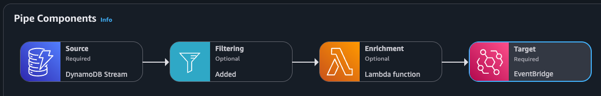

# Person Service

Serverless microservice (AWS CDK, TypeScript) to create: persons.

## Happy flow
```
POST /person -> API Gateway -> Lambda -> DynamoDB
                                      -> DynamoDB Stream -> EventBridge Pipe (filter INSERT + enrich Lambda) -> EventBridge (PersonCreated)
```

## API

`POST /person` (IAM authentication: requests must be sigv4-signed, and the caller needs `execute-api:Invoke`)

With an AWS SSO profile:

```bash
aws sso login --profile my-profile
eval "$(aws configure export-credentials --profile my-profile --format env)"

curl -X POST "$API_URL/person" \
  --aws-sigv4 "aws:amz:eu-west-1:execute-api" \
  --user "$AWS_ACCESS_KEY_ID:$AWS_SECRET_ACCESS_KEY" \
  -H "x-amz-security-token: $AWS_SESSION_TOKEN" \
  -H 'Content-Type: application/json' -d '{
  "firstName": "Miep", "lastName": "Hoefijzer", "phoneNumber": "+31612345678",
  "address": {"street": "Rijksstraatweglaan", "houseNumber": "29", "postalCode": "1221DE", "city": "Amsterdam", "country": "NL"}
}'
```

A Bruno collection exists in `bruno/`. It signs with the AWS profile (AWS sigv4 auth), so run `aws sso login --profile <profile>` first.

- `201` with the stored person (including generated ULID `personId`, `createdAt`)
- `400` on invalid JSON or validation errors (for instance, phone number must be E.164)
- `500` on downstream failure

`GET /person/{personId}` (IAM authentication): `200` with the person, `404` if unknown, `400` if the id is not a valid ULID.
Reads are strongly consistent.

`GET /person?limit=25&nextToken=...` (IAM authentication): newest first, `limit` 1-100 (default 25), returns `{ items, nextToken? }`;
pass `nextToken` back to get the next page (`400` on an invalid `limit` or `nextToken`). It reads from a GSI, so it is
eventually consistent: a just-created person may take a moment to appear in the list.

## Event



Emitted by an EventBridge Pipe reading the table's stream (only `INSERT`s of `PERSON` items; failed deliveries go to an SQS DLQ). Bus `person-service-<stage>`, source `com.example.person-service`, detail-type `PersonCreated`:
`{ "version": 1, "person": { ... } }`. Other services subscribe with their own rules on this bus. Bus exists per stage.

## Deploy

Stages are defined in `cdk.json` (`dev`, `prod`). Each gets its own stack: so also its own table, bus, and API.

```bash
npm ci
npm run deploy:dev
npm run deploy:prod
```

After a deployment, the API URL (`ApiUrl`) and event bus name (`EventBusName`) are printed as stack outputs; use the API URL as `baseUrl` in the Bruno environment.

For production, table retained with point-in-time recovery, longer log retention.
Everything is on-demand (API Gateway, Lambda, DynamoDB).

## Design notes / trade-offs

- Single-table design: table `person-service-<stage>`, keys `pk` (`PERSON#<ulid>`) and `sk` (`PROFILE`), plus `entityType`.
  `gsi1` (`gsi1pk=PERSON`, `gsi1sk=<ulid>`) backs the list endpoint. Every person shares one index partition key for now.
  This may cause for hot partitions if the service grows, but it's a simple design for now.
- Events come from the stream, so they are only emitted for committed writes and are retried. Delivery is eventually
  consistent: the API response doesn't wait for the event.
- Validation happens in the Lambda function with zod (API Gateway only checks that a body exists/is JSON-shaped).
- Auth is IAM (sigv4), which suits service-to-service calls, as well as AWS SSO users like myself.
- The ULID `personId` encodes its creation time (`createdAt` is derived from it); not sensitive for this data. I personally like ULIDs because they are sortable and don't leak the number of items in the table. I use this pattern exhaustively ;).
- The Pipe uses the L2 constructs (`@aws-cdk/aws-pipes-*-alpha`) from the alpha packages, pinned to the `aws-cdk-lib` version. Personally I prefer using these over the L1 construct.

## Develop

`npm test` (handler tests with mocked AWS SDK calls, CDK tests), `npm run build` (type-check).
